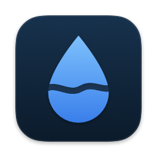
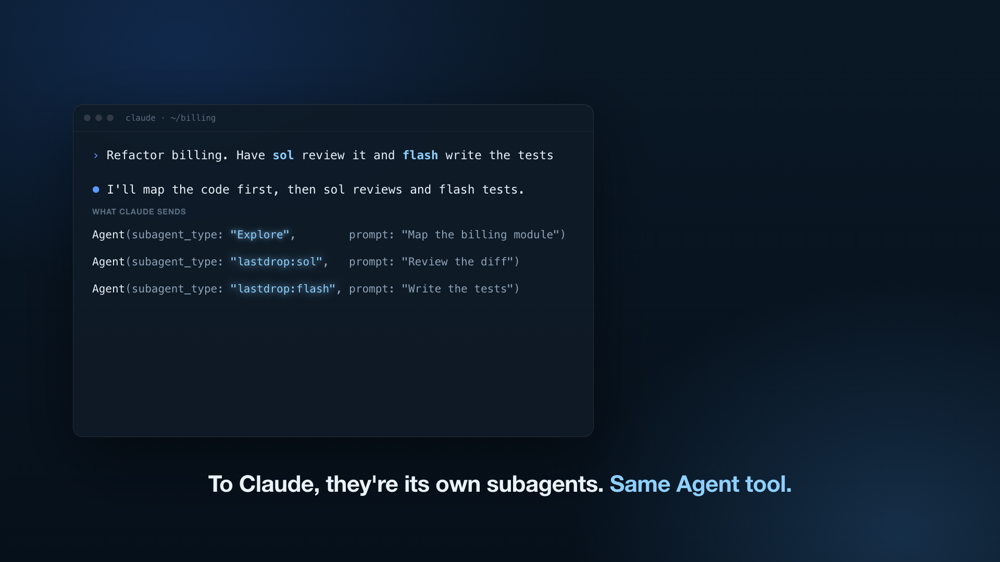
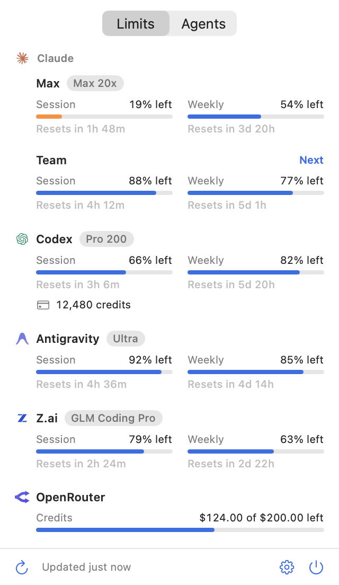
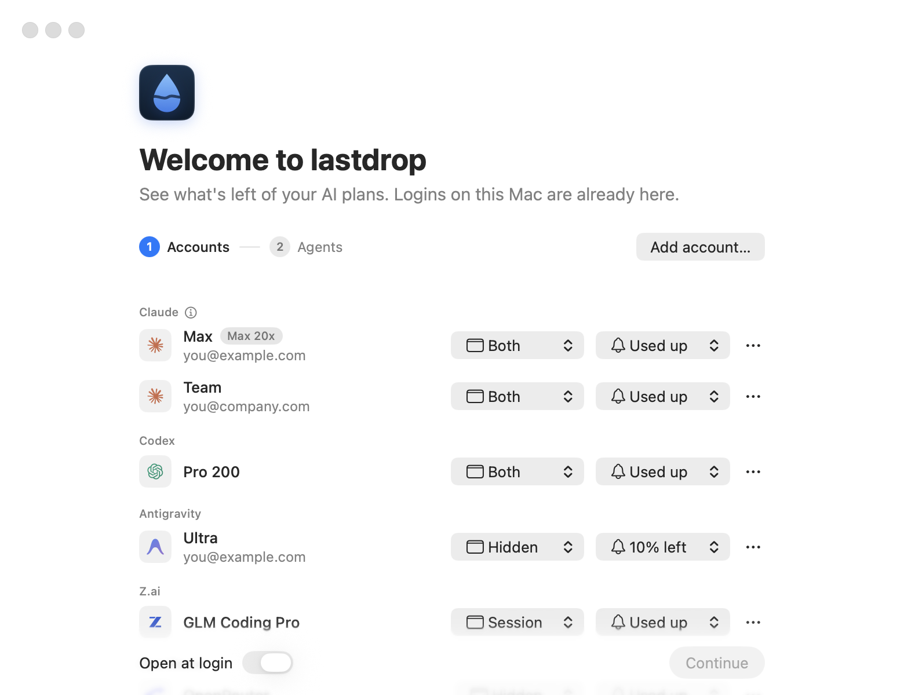
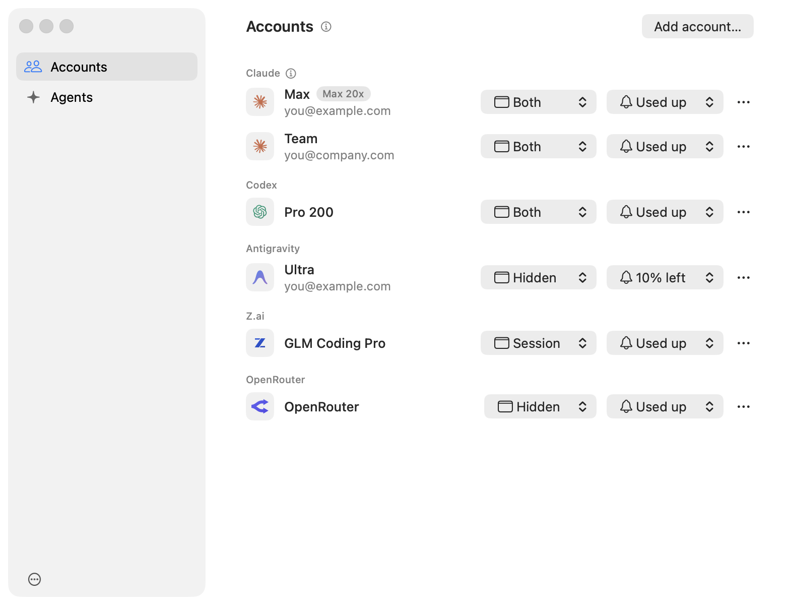
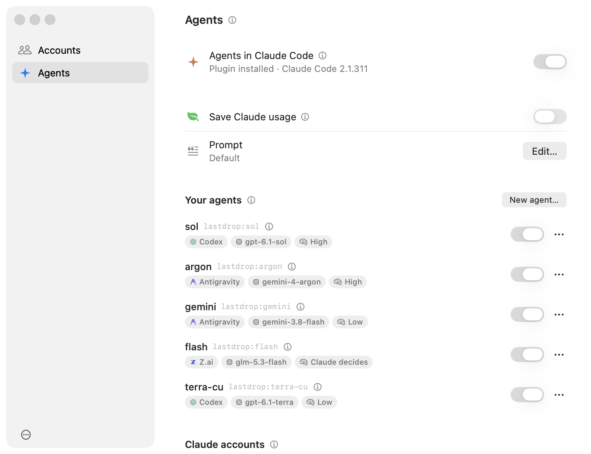

<p align="center">
  
</p>

<h1 align="center">lastdrop</h1>

<p align="center"><b>Every last drop out of your AI plans.</b></p>

<p align="center">
  A macOS menu bar app that shows what's left of every AI plan you pay for,<br>
  and lets Claude Code run its subagents on whichever of them has room.
</p>

<p align="center">
  <a href="https://github.com/amontlabs/lastdrop/releases/latest">Download</a> ·
  <a href="docs/media/lastdrop.mp4">Watch the video</a> ·
  <a href="#install">Install</a>
</p>

<p align="center">
  <a href="docs/media/lastdrop.mp4"></a>
</p>

<p align="center">
  <picture>
    <source media="(prefers-color-scheme: dark)" srcset="docs/images/panel-limits-dark.png">
    
  </picture>
</p>

## What it does

- **Every limit at a glance.** Claude, Codex, Antigravity, Z.ai and OpenRouter: what's left of each session
  and week, when it resets, and any extra credits. Pick what each account shows in the menu bar.
- **Several accounts per plan.** A Max and a Pro, a work and a personal account: add them all.
- **Subagents on the account with room.** When Claude Code starts a subagent, lastdrop runs it on whichever
  of your Claude accounts has the most left. Nothing changes in how you work.
- **Your other plans as agents.** Codex, Gemini (Antigravity), GLM (Z.ai) and any OpenRouter model show up
  in Claude Code as agents it can call, next to its own.
- **Save Claude usage.** One switch, and Claude plans and checks the work while your other plans do the
  coding, searching and research.

## Install

You need macOS 15 or later. The agent features need [Claude Code](https://docs.anthropic.com/en/docs/claude-code).

1. Download `lastdrop.zip` from the [latest release](https://github.com/amontlabs/lastdrop/releases/latest)
   and move `lastdrop.app` to Applications.
2. The app isn't notarized yet, so clear the download flag before the first launch:

```sh
xattr -dr com.apple.quarantine /Applications/lastdrop.app
```

3. Open it. Setup walks you through two steps: your accounts, then agents (optional).

To build it yourself, you need the Swift 6 toolchain (Command Line Tools are enough):

```sh
git clone https://github.com/amontlabs/lastdrop.git
cd lastdrop
./script/build_app.sh
cp -R dist/lastdrop.app /Applications/
```

<p align="center">
  <picture>
    <source media="(prefers-color-scheme: dark)" srcset="docs/images/setup-dark.png">
    
  </picture>
</p>

## Accounts

Logins already on your Mac show up on their own. Everything else is one button in **Settings → Accounts →
Add account…**:

| Plan | How you connect it | Agents |
| --- | --- | --- |
| Claude | Sign in with Claude, in your browser | Subagents |
| Codex | Sign in with ChatGPT, in your browser | Yes |
| Antigravity | Sign in with Google, in your browser | Yes, first account only |
| Z.ai | A Coding Plan API key | Yes |
| OpenRouter | An API key | Yes |

Add as many accounts of a plan as you like. Each account has its own row: what it shows in the menu bar
(nothing, its session, its week, or both) and when it notifies you (at 25% left, 10% left, or used up).
With nothing picked, the menu bar shows just the drop.

<p align="center">
  <picture>
    <source media="(prefers-color-scheme: dark)" srcset="docs/images/settings-accounts-dark.png">
    
  </picture>
</p>

## Agents in Claude Code

Turn on **Agents in Claude Code** in **Settings → Agents**. lastdrop adds its plugin to Claude Code for all
your sessions, in the terminal and in the Claude desktop app.

**Subagents on your other Claude accounts.** When Claude starts a subagent, it runs on the account with
the most left (by default, until it has 10% of its session or week left). The panel marks that account
**Next**. A session never sends subagents to its own account. The subagent is a normal Claude Code process
in the same folder, with the same model, permissions and MCP servers. You can watch it, background it,
message it or stop it like any other, and `/agents-elsewhere` lists what runs where.

**Your agents on other plans.** Click **New agent…**, give it a name, say when Claude should use it, and
pick the plan, model and effort. Claude sees it as `lastdrop:<name>` and picks it by its description. On a
plan with several accounts, it runs on the one with the most left.

**Save Claude usage.** Claude hands implementation, exploration, reviews and research to your agents
first. **Edit…** shows the exact prompt it adds, and lets you rewrite it.

<p align="center">
  <picture>
    <source media="(prefers-color-scheme: dark)" srcset="docs/images/settings-agents-dark.png">
    
  </picture>
</p>

How it works, with the tests behind it: [docs/claude-accounts.md](docs/claude-accounts.md) and
[docs/agents.md](docs/agents.md).

## Privacy

Everything stays on your Mac. lastdrop reads usage from each provider with the logins you already have, and
keeps its own keys in the keychain. The one thing it writes back is an expiring Codex token, renewed the
way the Codex CLI does it. Logs are in `~/Library/Logs/lastdrop`.

## Development

```sh
swift run lastdrop           # run without building the app bundle
swift run lastdrop --print   # fetch every account once and print it
swift test
claude plugin test ClaudePlugin/lastdrop
```

`LASTDROP_DEMO=1 swift run lastdrop --snapshots <folder>` renders every screen with made-up accounts.

## License

MIT, see [LICENSE](LICENSE). Provider logos come from [OpenUsage](https://github.com/robinebers/openusage)
(MIT), which also inspired this app.
