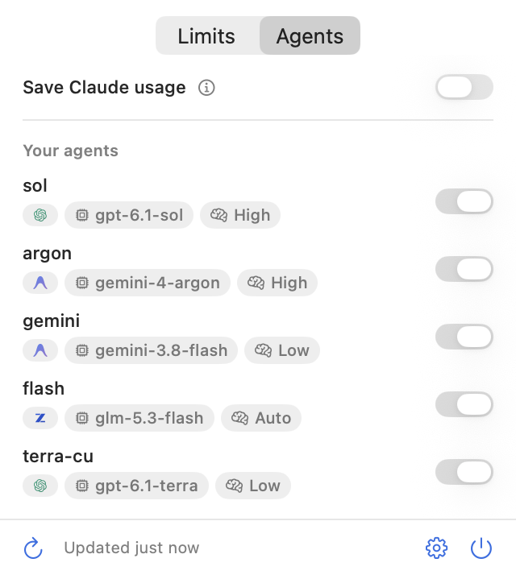

<p align="center">
  
</p>

<h1 align="center">lastdrop</h1>

<p align="center">
  Use any AI subscription as built-in subagents in Claude Code,<br>
  load-balanced across your accounts. A macOS menu bar app.
</p>

<p align="center">
  <a href="https://github.com/amontlabs/lastdrop/releases/latest">Download</a> ·
  <a href="#install">Install</a>
</p>

https://github.com/user-attachments/assets/71e4c020-37c8-4412-8ccc-0d7b69176202

<p align="center">
  <picture>
    <source media="(prefers-color-scheme: dark)" srcset="docs/images/panel-agents-dark.png">
    
  </picture>
</p>

## What it does

- **Any subscription as a subagent.** Make an agent on any connected plan: a name, when to use it, a model
  and an effort.
- **Built in for Claude.** Claude calls it like its own subagents: `Agent({ subagent_type: "lastdrop:<name>" })`.
- **Load-balanced.** Add several accounts per plan, Claude included. Each subagent runs on the account with
  the most usage left.
- **Save Claude usage.** A switch that encourages Claude to delegate to your agents.
- **Limits in the menu bar.** Usage left on each account, and when it resets.

## Install

You need macOS 15 or later. The agent features need [Claude Code](https://docs.anthropic.com/en/docs/claude-code).

1. Download `lastdrop.zip` from the [latest release](https://github.com/amontlabs/lastdrop/releases/latest)
   and move `lastdrop.app` to Applications.
2. The app isn't notarized yet, so clear the download flag before the first launch:

```sh
xattr -dr com.apple.quarantine /Applications/lastdrop.app
```

3. Open it and follow the setup: your accounts, then agents (optional).

lastdrop keeps itself up to date: it looks for a new release every hour and downloads it in the background. Your
panel then offers **Restart**. Running subagents keep going, and **Settings → Updates** has the switch. Coming from
Headroom 0.1.0, install this version by hand once.

To build it yourself, you need the Swift 6 toolchain (Command Line Tools are enough):

```sh
git clone https://github.com/amontlabs/lastdrop.git
cd lastdrop
./script/build_app.sh
rm -rf /Applications/lastdrop.app && cp -R dist/lastdrop.app /Applications/
```

<p align="center">
  <picture>
    <source media="(prefers-color-scheme: dark)" srcset="docs/images/setup-dark.png">
    
  </picture>
</p>

## Agents in Claude Code

Turn on **Agents in Claude Code** in **Settings → Agents**. It works in the terminal and in the Claude
desktop app.

**Your agents.** Click **New agent…** and pick a name, when Claude should use it, a plan, a model and an
effort. Claude sees it as `lastdrop:<name>`.

**Claude's subagents.** They run on your other Claude account with the most usage left (down to 10% by
default), never on the session's own account. The panel marks that account **Next**. Each one is a normal
Claude Code process with the same folder, model, permissions and MCP servers. `/agents-elsewhere` lists
what runs where.

**Save Claude usage.** Adds a prompt that encourages Claude to delegate implementation, exploration, reviews
and research. **Edit…** shows it and lets you change it.

<p align="center">
  <picture>
    <source media="(prefers-color-scheme: dark)" srcset="docs/images/settings-agents-dark.png">
    
  </picture>
</p>

How it works, with the tests behind it: [docs/claude-accounts.md](docs/claude-accounts.md) and
[docs/agents.md](docs/agents.md).

## Accounts

Logins already on your Mac show up on their own. To add one, use **Settings → Accounts → Add account…**

| Plan | How you connect it | Agents |
| --- | --- | --- |
| Claude | Sign in with Claude, in your browser | Subagents |
| Codex | Sign in with ChatGPT, in your browser | Yes |
| Antigravity | Sign in with Google, in your browser | Yes, first account only |
| Z.ai | A Coding Plan API key | Yes |
| OpenRouter | An API key | Yes |

Add as many accounts per plan as you like. For each, pick what the menu bar shows and when you get notified.

<p align="center">
  <picture>
    <source media="(prefers-color-scheme: dark)" srcset="docs/images/settings-accounts-dark.png">
    
  </picture>
</p>

## Privacy

Everything stays on your Mac. lastdrop reads usage from each provider with the logins you already have, and
keeps its own keys in the keychain. The one thing it writes back is an expiring Codex token, renewed the
way the Codex CLI does it. Logs are in `~/Library/Logs/lastdrop`.

## Development

```sh
swift run lastdrop           # run without building the app bundle
swift run lastdrop --print   # fetch every account once and print it
swift test
claude plugin test ClaudePlugin/lastdrop
```

`LASTDROP_DEMO=1 swift run lastdrop --snapshots <folder>` renders every screen with made-up accounts.

## License

MIT, see [LICENSE](LICENSE). Provider logos come from [OpenUsage](https://github.com/robinebers/openusage)
(MIT), which also inspired this app.
