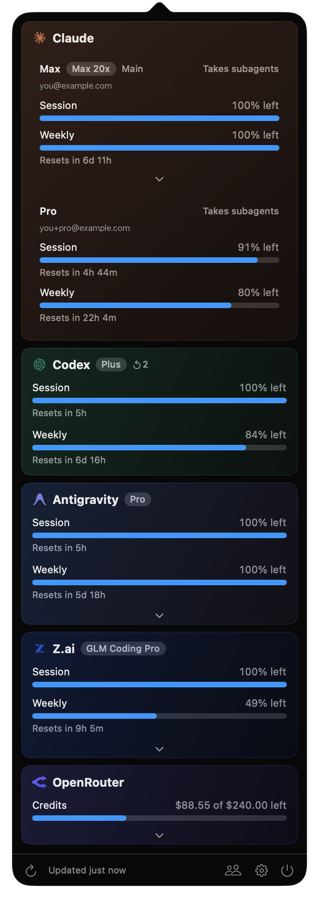
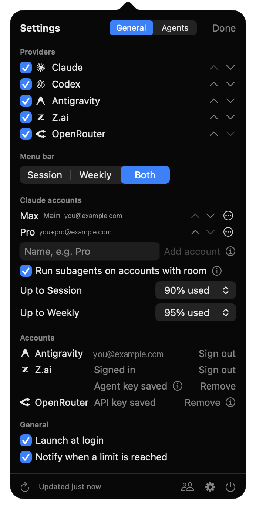
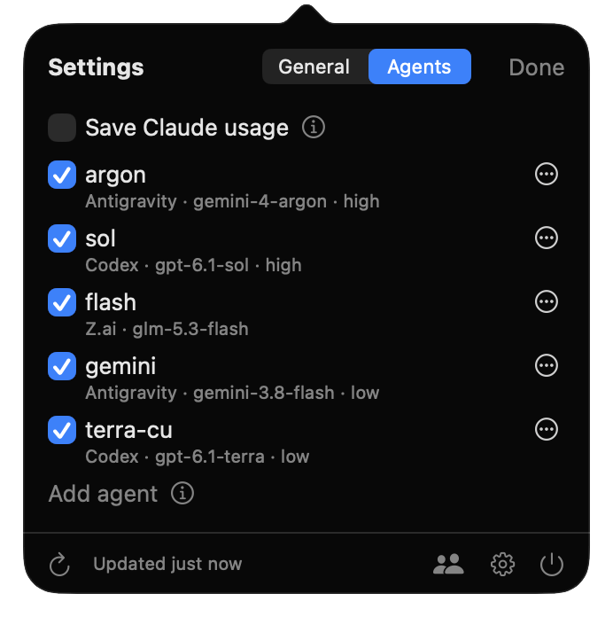

# Headroom

Headroom is a macOS menu bar app for people who code with AI agents on subscriptions. It shows how much of
your limits is left on **Claude**, **Codex**, **Antigravity**, **Z.ai** and **OpenRouter**, and it lets
Claude Code spend that room: subagents run on whichever of your Claude accounts has some left, and you can
add agents that run on the other providers.



## Why use it

- **See every limit at a glance.** The menu bar shows what is left of each provider's Session and Weekly
  limits. Click it for the details and reset times.
- **Use all your Claude accounts.** With a Max plan and a Pro plan, or a work and a personal account, Claude
  Code runs subagents on the account that has room instead of hitting the limit on one.
- **Use the other plans you pay for.** Give Claude agents backed by Codex, Gemini (Antigravity), GLM (Z.ai)
  or any OpenRouter model, and it calls them like its own subagents.

## Install

You need macOS 15 or later and the Swift 6 toolchain (Command Line Tools are enough).

```sh
git clone https://github.com/0xpolarzero/headroom.git
cd headroom
./script/build_app.sh
cp -R dist/Headroom.app /Applications/
open /Applications/Headroom.app
```

Headroom appears in the menu bar. If you don't see it on a Mac with a notch, macOS hid it for lack of
space: ⌘-drag other items away, or turn off providers you don't need in Settings.

## Turn on providers

Headroom picks up the logins you already have. Open **Settings** (gear icon) to turn providers on or off,
change their order, choose what the menu bar shows, and sign in where needed.

| Provider | How Headroom signs in |
| --- | --- |
| Claude | Your Claude Code login. If it expired, run `claude`. |
| Codex | Your Codex CLI login (`~/.codex/auth.json`). Sign in with `codex`. |
| Antigravity | **Sign in with Google** in Settings, or the Antigravity app's login. |
| Z.ai | **Sign in** in Settings, or `ZAI_API_KEY`. |
| OpenRouter | An API key in Settings, or `OPENROUTER_API_KEY`. A management key also shows spend per key. |

Headroom only reads usage. The one exception: it renews an expiring Codex token the way the Codex CLI does
and writes it back to `auth.json`. Its own logins are kept in the keychain.

## Several Claude accounts



In **Settings → Claude accounts**, type a short name (for example "Pro") and click **Add account**. Terminal
opens Claude Code for that account; sign in there (type `/login` if it doesn't ask). Each account has its
own login and sessions but shares your settings, skills, agents, plugins and CLAUDE.md from `~/.claude`.

The panel and the menu bar then show every account's limits.

## Subagents on accounts with room

Turn on **Run subagents on accounts with room**. This installs Headroom's Claude Code plugin for all your
sessions. Nothing changes in how you use Claude Code: when Claude starts a subagent and another of your
accounts has room, the subagent runs there. When none has room, Claude uses its normal subagents.

- An account has room while it is under both thresholds set in Settings (by default 90% used of the
  Session and of the Weekly limit). The one with the most room wins. A session never sends subagents to its own account.
- The subagent is a normal Claude Code process signed in to that account, in the same folder, with the same
  model, effort, permission mode and MCP servers. If the account's plan lacks the model (Pro has no Fable),
  it uses Sonnet.
- It shows up like any subagent: you can watch it, send it to the background, message it or stop it. The
  status line says where it runs, and `/agents-elsewhere` lists each one's steps.
- Forks, teammates and subagents started by a subagent stay on the session's own account.

Logs are in `~/Library/Logs/Headroom/subagents.log`. How it works, with the tests behind it:
[docs/claude-accounts.md](docs/claude-accounts.md).

## Agents on other providers



In **Settings → Agents**, click **Add agent** and choose a name, a description, a provider (Codex, Z.ai,
OpenRouter, Antigravity, or one of your Claude accounts), a model and an effort. Claude sees each enabled
agent as `headroom:<name>` next to its built-in agent types and picks one by its description, so write
the description for Claude: what the agent is good at.

- This needs the plugin, so turn on **Run subagents on accounts with room** too.
- An agent always runs on its provider. If the provider can't take it (signed out, out of usage, missing
  model), the call fails and Claude tells you why.
- Z.ai agents need a Coding Plan API key, saved in Settings; the website sign-in only reads usage.
- Changes apply from your next prompt, in every session.

**Save Claude usage** (off by default) asks Claude to hand substantial work (implementation, exploration,
reviews, research) to these agents first, and to do it itself only when none fits.

Design and details: [docs/agents.md](docs/agents.md).

## Refresh and alerts

Usage refreshes every 5 minutes, when you open the panel, and on ⌘R. After a failure Headroom keeps the
last good numbers and shows a warning icon; after 10 minutes without a refresh it marks the provider
**Outdated**. You get one notification when a Session or Weekly limit reaches 100%.

## Development

```sh
swift run Headroom           # run without building the app bundle
swift run Headroom --print   # fetch every provider once and print it
swift test
```

## License

MIT. Provider logos come from [OpenUsage](https://github.com/robinebers/openusage) (MIT), which also
inspired this app.
